# Lab 02 — Run Your First Security Audit

Poridhi Labs · Level: Beginner · Time: about 120 minutes

In Lab 01 you found risky things by reading files. In this lab, a tool finds them for you in about a minute. You will run an automatic security audit on a sample project, read the results, and save the report to your GitHub repository. You will not fix anything yet. Fixing starts in Lab 03.

You do **not** need a Gemini account for this lab.

## Lab Overview

In this lab, you will:

- Understand what a security audit is and why it helps.
- Learn what PASS, WARN, FAIL and INFO mean.
- Set up a fresh VM using your own GitHub repository.
- Run the audit tool on a sample project.
- Read the report and find the main problems.
- Save the report to GitHub.

## Before You Start

You need:

- Lab 01 finished. Your repository `gemini-security-labs-for-myself` exists on GitHub.
- Your GitHub token from Lab 01. It works for 30 days. If it expired, make a new one (Lab 01, Part 7, Step 2).
- A Poridhi VM. Docker is already installed on it.
- About 120 minutes.

### Answers to the Lab 01 knowledge check

1-b (in the terminal), 2-b (take actions), 3-a (hidden instructions that trick the AI), 4-b (ask you first), 5-a (the Audit), 6-b (so passwords are not uploaded).

## Part 1 — Concepts Explained

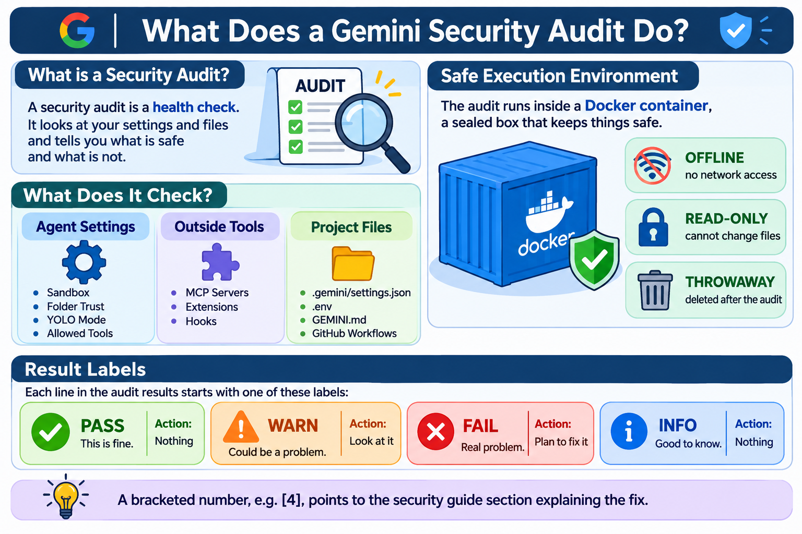

### What is a security audit?

A security audit is a health check. A tool looks at your settings and files and tells you what is safe and what is not. It is faster, and more careful, than checking by hand.

### What does this audit tool check?

It is a free, open-source tool. It looks at:

- The agent’s settings: sandbox, folder trust, YOLO mode and allowed tools.
- Outside tools: MCP servers, extensions and hooks.
- The project’s own files: `.gemini/settings.json`, `.env`, `GEMINI.md` and GitHub workflows.

### Is it safe to run?

Yes. The tool runs inside a **Docker container**, which is a sealed, throwaway box.

| Property | What it means |
| --- | --- |
| Offline | The box has no network, so it cannot send anything out |
| Read-only | It can look at your files but cannot change them |
| Throwaway | The box is deleted when the audit ends |

### How do I read the results?

Every line in the results starts with one label:

| Label | Meaning | What you do |
| --- | --- | --- |
| PASS | This is fine | Nothing |
| WARN | This could be a problem | Look at it |
| FAIL | This is a real problem | Plan to fix it |
| INFO | Good to know | Nothing |

The number in square brackets, like `[4]`, points to the section of the (security guide) that explains the fix.

Here is an example of what the screen looks like. Your results will be different.

```
FAIL  [4] The project trusts MCP servers, bypassing every confirmation
FAIL  [4] The project .env sets Gemini CLI variables
WARN  [2] Sandboxing is off (the default)
PASS  [2] Folder trust is on
PASS  [3] YOLO mode is disabled
...
Summary: 9 pass, 1 warn, 2 fail, 2 info
```

### What is an exit code?

When a command ends, it leaves a small number behind. This audit leaves `0` if there is no FAIL, and `1` if there is at least one FAIL. Automatic pipelines (CI) use this number to stop a build. You will check it in this lab.

### Key commands in plain words

| Command | What it means |
| --- | --- |
| `git clone` | Download a repository from GitHub to this VM |
| `bash file.sh` | Run a script file |
| `cd` | Go into a folder |
| `ls` | List the files in a folder |
| `cat file` | Show what is inside a file |
| `cp` | Copy a file |
| `echo $?` | Show the exit code of the last command |

## Part 2 — Hands-on: Run the Audit

A new VM starts empty, so first you get your work back from GitHub.

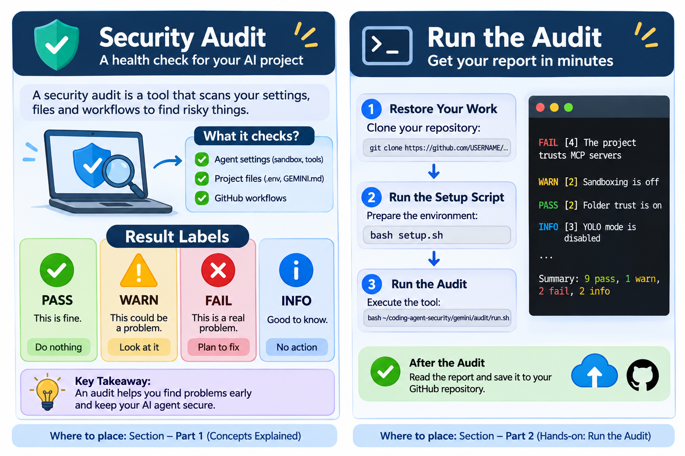

### Step 1: Tell Git who you are

Open the **Terminal** tab. Use your own name and email.

```
git config --global user.name "Your Name"
```

```
git config --global user.email "you@example.com"
```

### Step 2: Download your repository

Replace `USERNAME` with your GitHub username.

```
mkdir -p ~/code
```

```
cd ~/code
```

```
git clone https://github.com/USERNAME/gemini-security-labs-for-myself.git
```

```
cd gemini-security-labs-for-myself
```

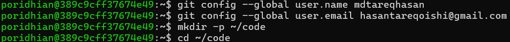

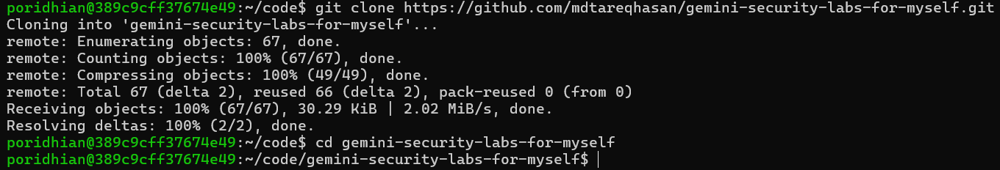

### Step 3: Run the setup script

The setup script does the boring work for you. It downloads the audit tool, builds it, copies the practice project into the `workspace` folder, and puts a weak sample Gemini settings file in `~/.gemini/` so the audit has something to find. It never overwrites your work.

```
bash setup.sh
```

The script has 5 steps and prints each one. It starts like this:

```
gemini-security-labs setup
==========================

==> Step 1 of 5: checking Docker
```

This can take 1 to 2 minutes the first time. Wait until the prompt comes back.
Output:

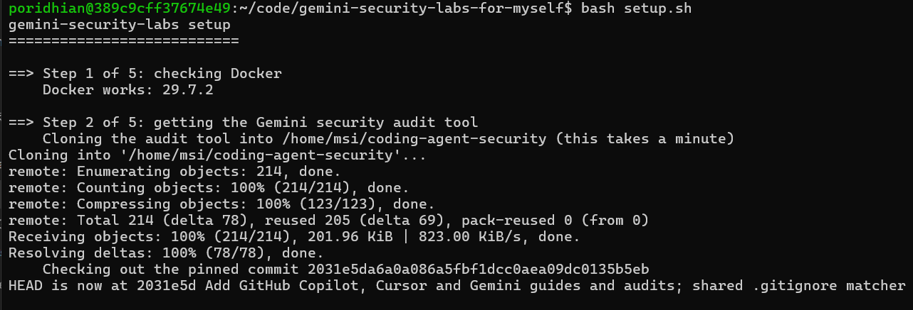

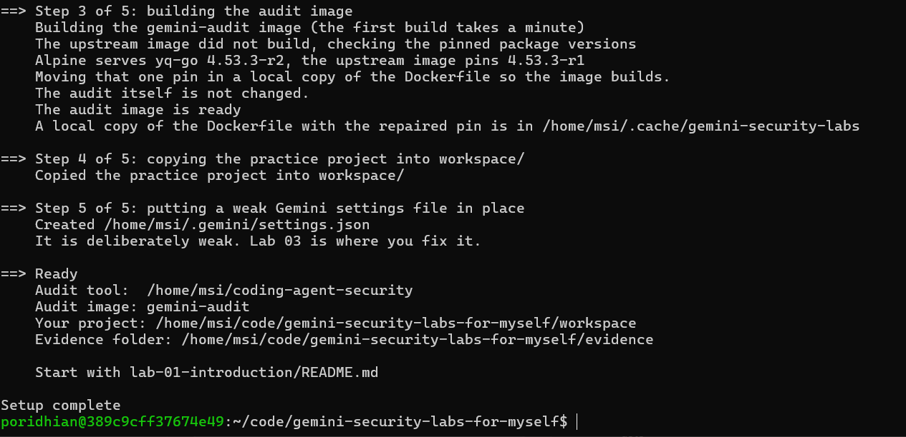

If you see `ERROR: Docker is installed but it is not working yet`, tell your instructor. Docker is already set up on Poridhi VMs, so this should not happen.

### Step 4: Go to the sample project

The audit looks at the folder you are standing in. So go into the sample project first.

```
cd workspace
```

### Step 5: Run the audit

```
bash ~/coding-agent-security/gemini/audit/run.sh
```

Output:

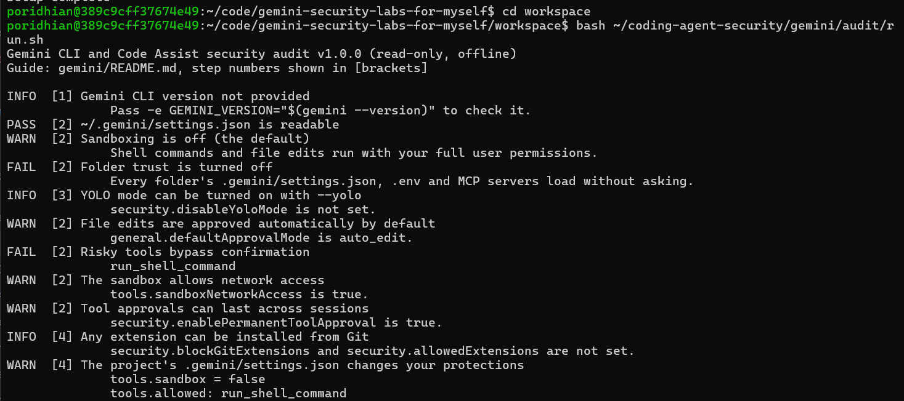

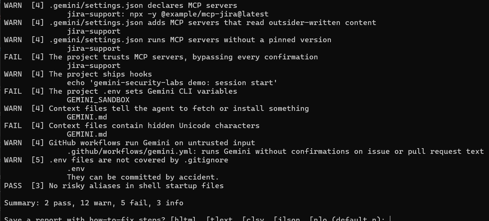

Results scroll on the screen. This can take about a minute, especially the first time, if the tool still has to build its sealed box. At the end you see a summary and a question:

```
Save a report with how-to-fix steps? [h]tml, [t]ext, [c]sv, [j]son, [n]o (default n):
```

Type `t` and press Enter. This saves a text report that is easy to read in the terminal.

### Step 6: Check the exit code

Run this right after the audit:

```
echo $?
```

You should see `1`. It means at least one FAIL was found.

### Step 7: Read your report

```
ls ~/gemini-audit-reports
```

```
cat ~/gemini-audit-reports/*.txt
```

Each finding explains why it matters and how to fix it. You do not need to understand every line.
Output:

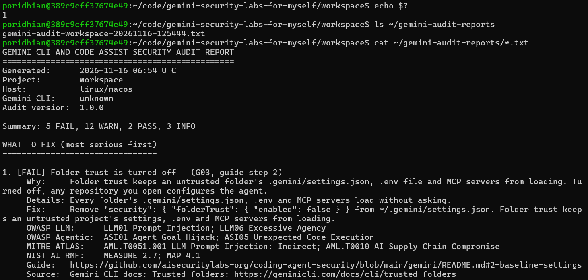

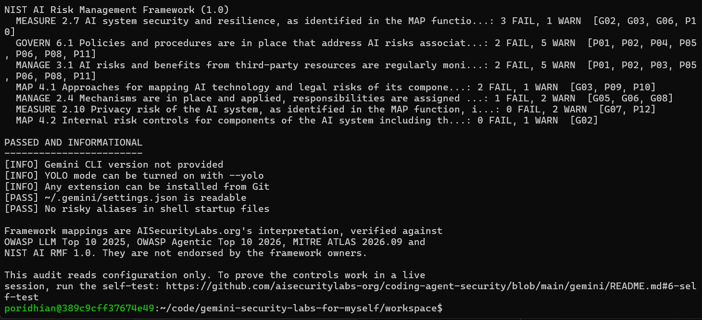

### Step 8: Find the main problems

Look for FAIL and WARN lines first. Here is what to look for:

| Area | Look for words like | What it means |
| --- | --- | --- |
| Outside tools (MCP) | `trust`, `unpinned` | A tool that skips your approval, or can change without warning |
| Project .env | `GEMINI_` variables | The project quietly changes Gemini’s safety settings |
| Project settings | `.gemini/settings.json` lowers protections | A repository can switch off your safety rules |
| Instruction files | hidden Unicode, fetch instructions | Hidden commands inside text files |
| Workflows | `run-gemini-cli` | A GitHub robot that may be too powerful |

### Step 9: Save your results

You are still inside `workspace`. Copy the report into a folder for this lab in your repository:

```
mkdir -p ../lab-02-security-audit/lab-02
```

```
cp ~/gemini-audit-reports/*.txt ../lab-02-security-audit/lab-02/
```

**Check before you share.** If your repository is public, everyone can read your report. The `grep` command searches for words inside files. Look for secret-looking words:

```
grep -n -i -E "key|password|token|secret" ../lab-02-security-audit/lab-02/*.txt
```

It is fine to see lines that contain these words. It is **not** fine to see a real password or key. In this lab all values are fake, and the tool also hides secret-looking values.

Now create a short summary file:

```
cat > ../lab-02-security-audit/lab-02/summary.md << 'EOF'
# Lab 02 Summary
1. Number of FAIL results:
2. Number of WARN results:
3. The most serious problem I found:
4. Which file it is in:
5. How I think it can be fixed:
EOF
```

Open it and fill in your answers:

```
nano ../lab-02-security-audit/lab-02/summary.md
```

Output:

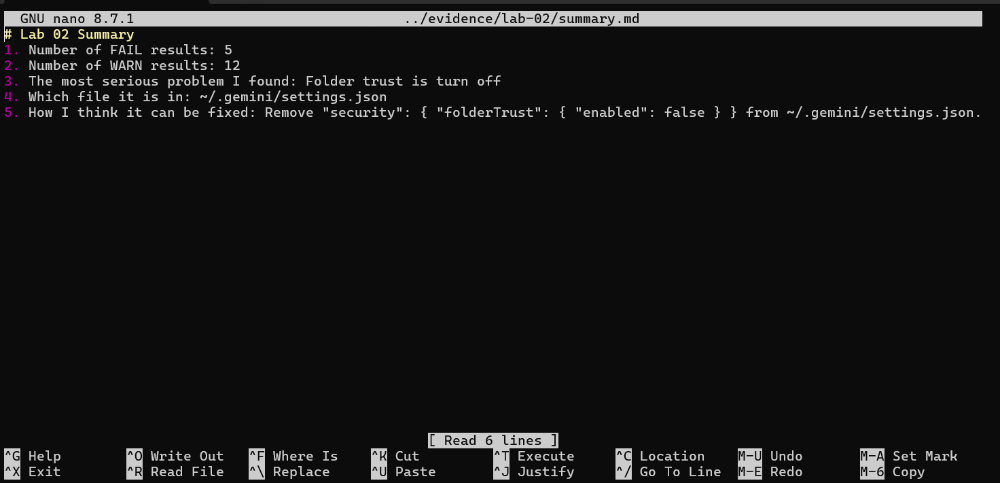

To save in nano: press `Ctrl+o`, then `Enter`, then `Ctrl+x` to exit.

### Step 10: Save and push to GitHub

```
cd ~/code/gemini-security-labs-for-myself/lab-02-security-audit
```

```
git status
```

```
git add lab-02/
```

```
git commit -m "Complete Lab 02"
```

```
git push origin main
```

When Git asks for a password, paste your **token**. It does not show on the screen. That is normal.
Output:

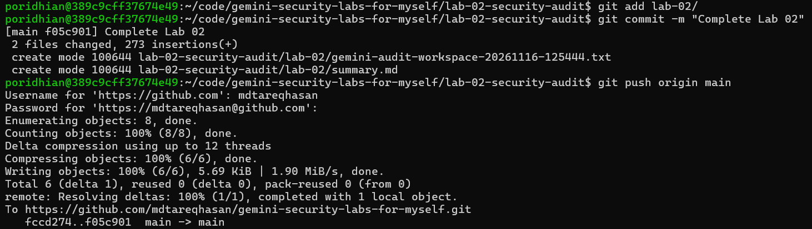

Open your repository on GitHub. You should see the `lab-02-security-audit/lab-02` folder with your report and summary.

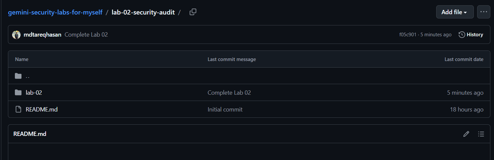

## Summary

You learned:

- A security audit finds problems automatically, so you do not have to hunt by hand.
- PASS, WARN, FAIL and INFO tell you how serious each finding is.
- The tool is safe: offline, read-only and throwaway.
- You ran an audit, read a report and saved it to GitHub.